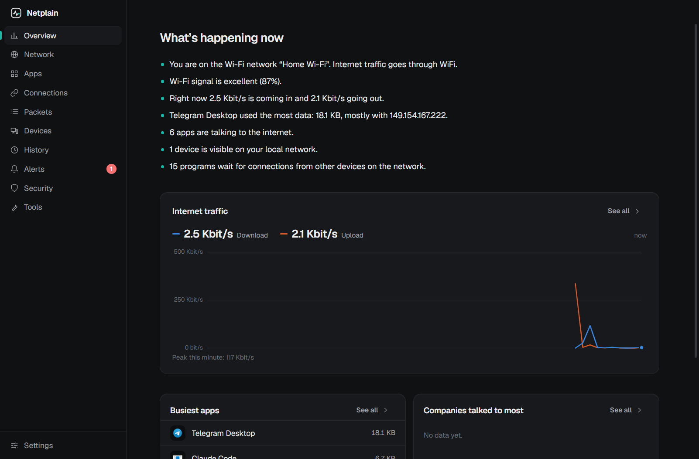
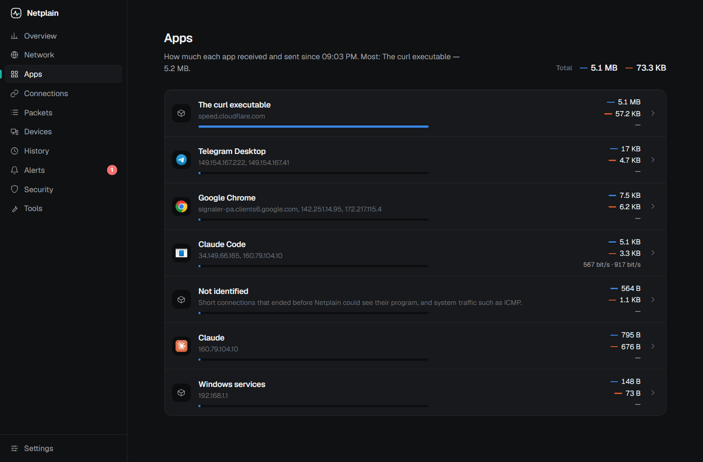
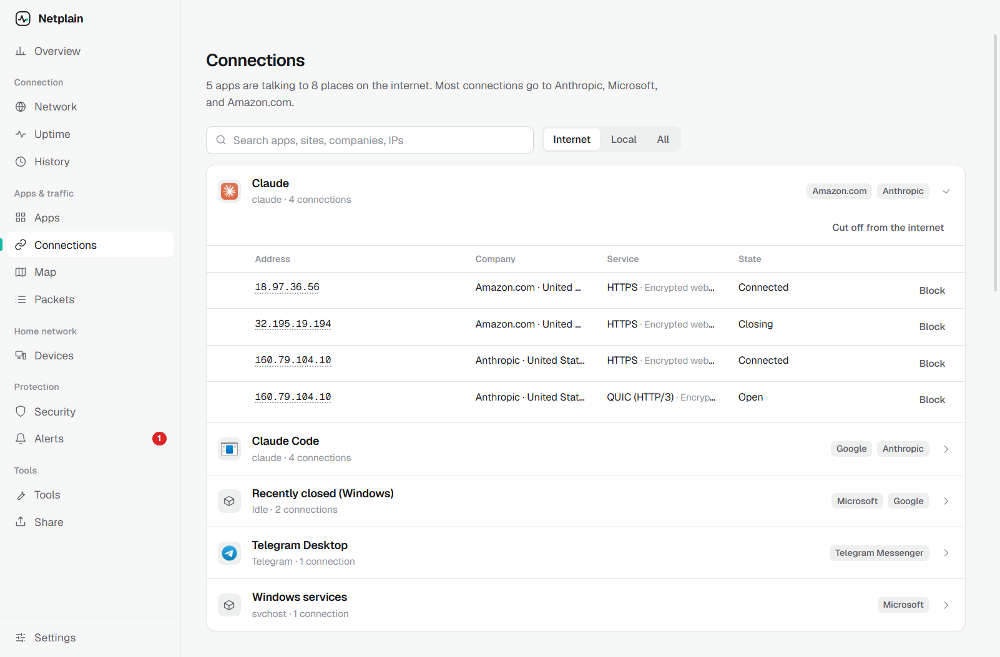
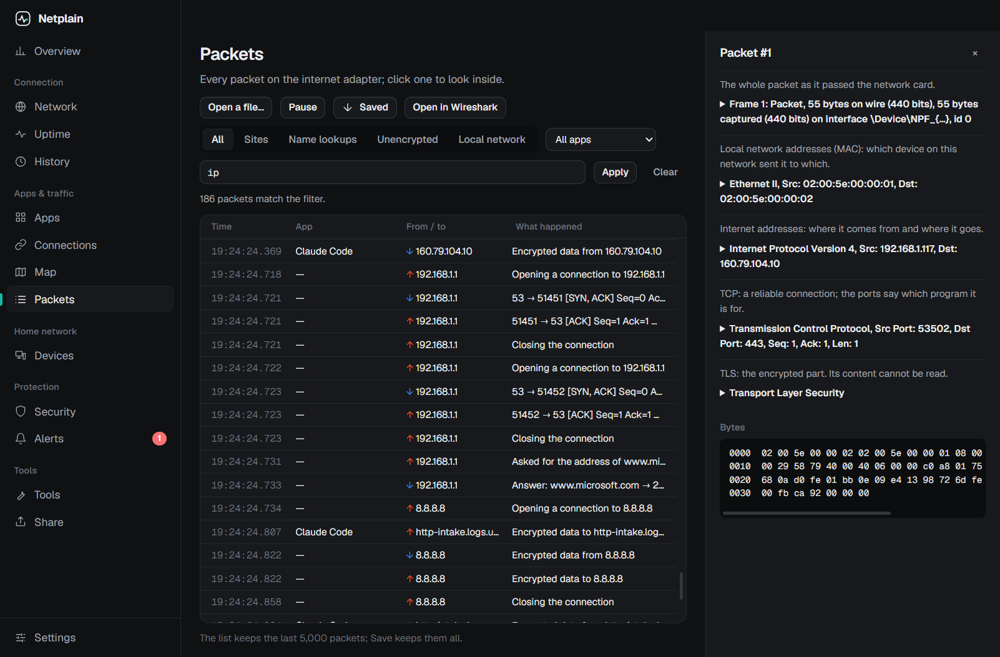
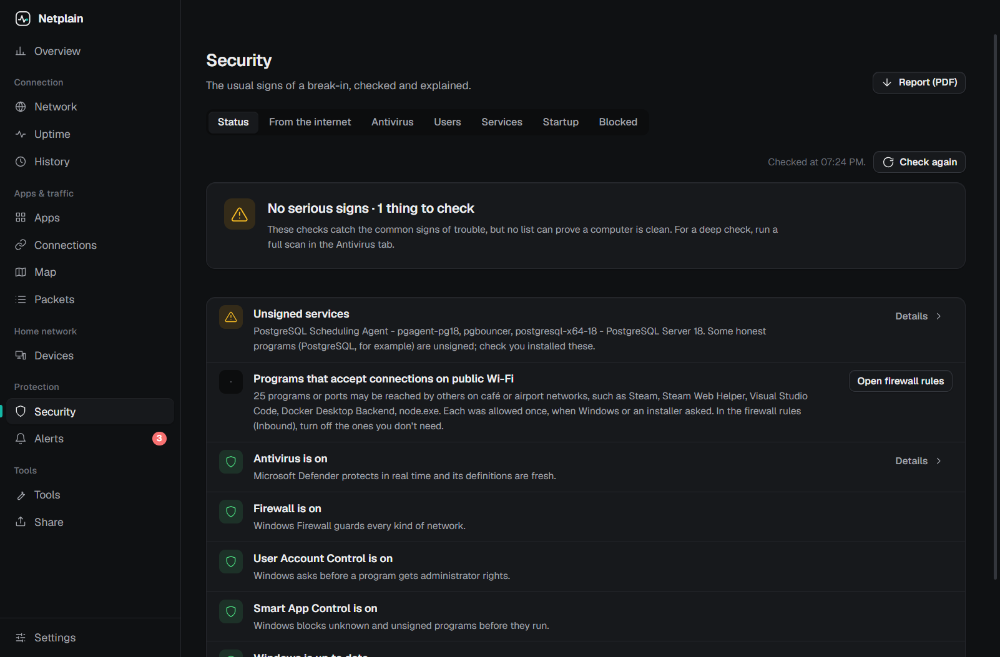

# Netplain

See what your computer does on the network, in plain language — without `ipconfig`, `netstat` or Wireshark filters. English and Uzbek.



## What it shows

- **Overview** — what is happening now, in sentences: which network, how good the signal is, which app uses the most data.
- **Network** — every adapter explained (what a VirtualBox or WSL adapter is), Wi-Fi signal, band and security, IP / router / DNS, live traffic.
- **Apps** — data received and sent by each app, and the sites it talked to. Needs Wireshark.
- **Connections** — which app talks to which company and country; programs waiting for connections (open ports): search a port to see who holds it, and stop that program (never the system's own).
- **Packets** — every packet in plain words, Wireshark display filters, full details, save as `.pcapng` or open in Wireshark; open a `.pcap`/`.pcapng` file for a summary (protocols, busiest addresses, names) that points out logins sent in the clear (never the password) and port scans.
- **Devices** — who is on your local network and who made each device; scan a device's ports or wake a computer (Wake-on-LAN) from its row.
- **History** — data per hour and day, per app, adapter and network, kept 90 days; a monthly data limit (for mobile internet or a hotspot) warns at 80% and 100%.
- **Uptime** — is the internet steady? The router, the internet and name lookups are checked every 15 seconds; every drop is logged with where it broke (Wi-Fi, router, provider or DNS), next to 24 hours of response times; your own sites, server ports and hosts are watched too, with alerts when one goes down or its https certificate runs out.
- **Alerts** — a new app went online, a new port opened to the network, unencrypted traffic, a known-bad address (your own list or FireHOL level 1), an internet drop of a minute or more, a stranger on your home network, a router address taken over (ARP spoofing), a changed DNS server or proxy.
- **Tools** — the terminal as buttons, each answer explained: "is the internet not working?" (adapter → address → router → DNS → internet), ping, traceroute, port check, public IP and fixes (clear DNS cache, renew IP, restart adapter); a speed test with delay under load (bufferbloat); a Wi-Fi analyzer (crowded channels, a quieter one for your router, unsafe networks nearby); a port scanner that names what answers; DNS records from four servers side by side, with SPF and DMARC explained; whois from the registry (RDAP); a website check (redirects, certificate chain, security headers); a subnet calculator for IPv4 and IPv6.
- **Share** — pick a site running on this computer (found by itself, by its page title) and give it an https:// link that opens anywhere, like ngrok without an account: Cloudflare Quick Tunnel or localhost.run, an optional password, and every visit with its headers and body, sent again with one click.
- **Always on** — closing the window keeps Netplain in the tray, with the live speed in its tooltip, so history and alerts keep going; it can start with Windows (or at login on macOS and Linux).
- **Security** — what the internet sees of your network (open ports Shodan found on your public address, ports your router opened through UPnP, a provider-shared address); on Windows also a "was I hacked?" check (antivirus, firewall, UAC, admins, unsigned startup programs and services, unsigned programs online, hosts redirects, proxy, DNS, updates), honest that no list proves a computer clean; Microsoft Defender scans and threat history; turn accounts, services and startup programs off and on; cut a program off the internet or block an address (Windows Firewall), and undo it; save it all as a PDF report. Changes ask for admin rights through the system's own prompt.

| Apps | Connections |
| --- | --- |
|  |  |
| **Packets** | **Security** |
|  |  |

## Install

Download the installer for your system from [Releases](https://github.com/NeoCode-02/netplain/releases).

The builds are not code-signed yet, so the system warns the first time:

- **Windows** — SmartScreen: *More info → Run anyway*. With Smart App Control on, Windows may refuse unsigned apps altogether.
- **macOS** — right-click the app → *Open*; if it says the app is damaged: `xattr -cr /Applications/Netplain.app`.
- **Linux** — `chmod +x Netplain-*.AppImage`, then run it.

Optional: [Wireshark](https://www.wireshark.org/) — Netplain uses its engine (`tshark`) for per-app traffic, packets and device makers. Without it, everything else works.

## Privacy

Everything is read on your computer; there is no telemetry. Netplain goes online only:

- when you press a button that says so — the location database ([DB-IP Lite](https://db-ip.com), ~9 MB), FireHOL level 1 from GitHub, your public IP from api.ipify.org, Cloudflare's `cloudflared` from its GitHub releases (checksum and, on Windows, Cloudflare's signature are checked);
- when you use a tool that asks the internet — the speed test (speed.cloudflare.com, about 100 MB or more), DNS records (your DNS plus 1.1.1.1, 8.8.8.8 and 9.9.9.9), whois (rdap.org, which forwards to the registry), the view from the internet (your public address to internetdb.shodan.io), and the address you scan or check;
- while you share a local site — through Cloudflare or localhost.run, which carry the visits to it;
- while the internet-drop checks are on: one TCP handshake with 1.1.1.1 or 8.8.8.8 every 15 seconds, under 40 MB a month (off in Settings);
- once at start, to ask the GitHub API whether a new version is out (off in Settings).

## Development

```bash
npm install
npm run dev
```

Checks: `npm run lint`, `npm run typecheck`, `npm test`, `npm run build`, `npm run e2e` (drives the built app on your real network and saves screenshots to `e2e/shots/`; `E2E_DOCS=1` makes the README screenshots with this machine's names and hardware addresses replaced).

How data is read, per OS: Windows — .NET `NetworkInterface`, `netsh wlan`, `arp -a`, PowerShell (no admin rights); macOS — `ifconfig`, `netstat -ibn`, `networksetup`, `scutil`, `system_profiler`, `arp -an`, `lsof`; Linux — `/sys/class/net`, `/proc/net/*`, optional `nmcli`.

## License

MIT. IP geolocation by [DB-IP](https://db-ip.com) (CC BY 4.0), downloaded from inside the app.
